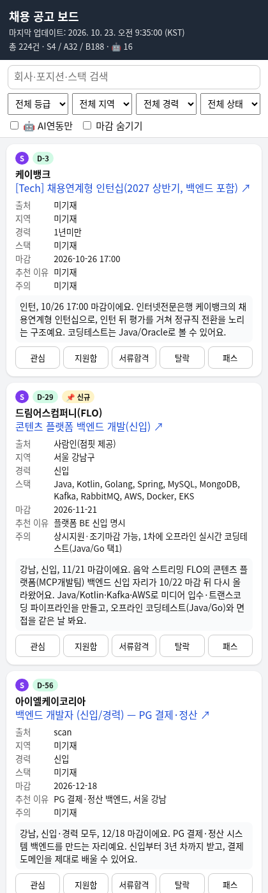
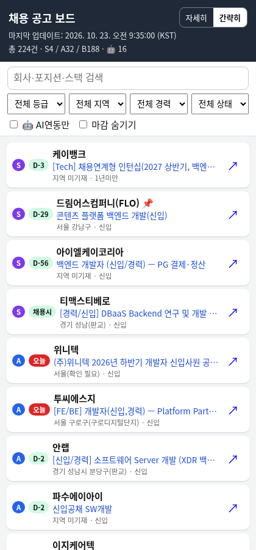

# 📋 Job Board — 백엔드 신입 채용 보드

[](https://henu-1004.github.io/job-board/)
[](https://github.com/henu-1004/job-board/commits/main)


> Java/Spring 백엔드 신입 채용 현황을 매일 아침 자동 수집해 S/A/B로 등급을 매긴 개인 채용 보드

## 👉 [**henu-1004.github.io/job-board 바로가기**](https://henu-1004.github.io/job-board/)

<p align="center"> </p>

## ✨ 주요 기능

- **🔥 오늘 꼭 볼 TOP 5** — 등급·마감 임박·신규·AI연동 점수로 고른 5건 (탭하면 해당 카드로 이동)
- **🗂️ 지난 공고 탭** — 마감·목록에서 빠진 공고를 영구 보관, 마감 월별로 묶어 검색·등급·🤖 필터 (내 지원 상태도 표시)
- **등급 정렬** — S → A → B, 같은 등급 안에서는 마감 임박 순
- **D-day 배지** — 오늘·내일 마감은 빨간색, 마감된 공고는 흐리게 맨 아래 표시, 마감 3일 후 자동 숨김
- **필터 & 검색** — 등급·지역·경력·내 상태 필터, 회사/포지션/스택 검색
- **🤖 AI연동** — LLM·RAG 등 AI 서비스와 연동하는 Spring 백엔드 공고만 모아보기
- **📌 신규** — 새로 올라온 공고 표시
- **지원 상태 저장** — 관심 / 지원함 / 서류합격 / 탈락 / 패스 (브라우저 localStorage)
- **간략히 / 자세히 보기** — 한 줄 요약 목록으로 훑어보고, 탭하면 전체 카드로 펼침 (선택 기억)
- **모바일 최적화** — 휴대폰에서 바로 확인 가능한 카드형 UI

## 🏷️ 등급 기준

| 등급 | 의미 | 기준 |
|:---:|---|---|
| **S** | 강력 추천 — 바로 검토·지원 | Java/Spring 백엔드 직무 + 신입 명시, 스택·도메인(핀테크/플랫폼) 적합 |
| **A** | 지원할 만함 | 백엔드 오너십(API·DB·인증·배포)이 분명하고 신입/1년 미만 지원 가능 |
| **B** | 일부 불일치지만 볼 만함 | 1~3년 요구, 인접 직무, 또는 '신입 가능'이지만 경력 채용 성향 |

- C 이하·3년 초과 경력 요구·채용연계 부트캠프는 수집하지 않습니다.
- 같은 등급 안에서는 신입 → 1년 미만 → 1~3년 순으로 우선합니다.

## 🔄 업데이트 방식

```
매일 ~09:00 KST  채용 사이트 스캔 (사람인 · 원티드 · 점핏 · 공식 채용 페이지)
       ↓          중복 제거 · 마감 확인 · S/A/B 등급 부여
data/<id>/jobs.json   커밋 & push  (마감·사라진 공고는 data/<id>/archive.json으로 이동, 삭제 없음)
       ↓
GitHub Pages     정적 사이트 자동 배포 (빌드 단계 없음)
```

## 👥 여러 사람 보드

상단 이름 버튼으로 사람을 전환합니다 (선택은 기억되며 `?p=hyojeong`처럼 URL로도 지정 가능). 지원 상태도 사람별로 따로 저장돼요.

**사람 추가 방법**
1. `data/people.json`에 `{"id":"newid","name":"이름"}` 추가 (id는 영문 소문자·숫자)
2. `data/newid/jobs.json` (`{"as_of":null,"items":[]}`)와 `data/newid/archive.json` (`{"updated":null,"items":[]}`) 생성
3. 데이터 게시: `publish-job-board.sh <overview.json> newid` (기본값 `hyunwoo`)

데이터가 없으면 "아직 공고 데이터가 없어요"가 표시됩니다.

## 🧩 `top5` 필드 (선택)

`data/<id>/jobs.json` 최상위에 `top5` 배열이 있으면 그대로 사용하고, 없으면 사이트가 자동 계산합니다.

```json
{
  "as_of": "2026-10-23T09:35+09:00",
  "items": [ ... ],
  "top5": [
    { "link": "https://www.saramin.co.kr/zf_user/jobs/view?rec_idx=55354317", "why": "S급·플랫폼 BE 신입·D-3" }
  ]
}
```

| 키 | 설명 |
|---|---|
| `link` | 공고 URL (`items[].url`과 일치). `id`(`job_id`)로도 지정 가능 |
| `why` | 추천 이유 한 줄 (생략 시 자동 생성) |

자동 계산: 마감·지원함·탈락·패스 공고 제외 → 등급(S 30 / A 20 / B 10) + 7일 내 마감(10−D) + 신규 5 + 🤖 3 점수 순 상위 5건.

## 🏆 대회 탭 (`?p=hyunwoo&m=contest`)

`data/people.json`에서 `"contests": true`인 사람에게만 상단에 **💼 채용 / 🏆 대회** 전환 버튼이 보입니다 (선택은 사람별로 기억, `m=contest`로 URL 지정 가능). `"sidegigs": true`이면 **💰 부업** 버튼이 함께 열립니다.

- 등급·분야·내 상태 필터, 검색, 마감 임박순 / 등급순 정렬, D-day 배지(오늘·내일 빨강, 2~3일 주황)
- 마감이 지난 대회는 진행 중 목록에서 자동으로 빠지고 **지난 대회** 탭에 표시 (`contests-archive.json`과 합쳐 월별로 묶음)
- 내 상태 저장: 관심 / 참가함 / 제출함 / 패스 (localStorage `contest-status-<id>`)

**`data/<id>/contests.json`**

```json
{ "as_of": "2026-11-18T12:20+09:00", "items": [ { "id": "smartcity-ai", "title": "...", "url": "https://...", "grade": "S", "deadline": "2026-12-14", ... } ] }
```

| 키 | 설명 |
|---|---|
| `id` | 고유 slug (영문 소문자·숫자·하이픈). 내 상태 저장 키 |
| `title` / `url` | 대회명 / 공식 공고 링크 |
| `host` | 주최·주관 (모르면 빈 문자열 → 표시 안 함) |
| `category` | `IT·해커톤` · `창업·지원사업` · `지자체·기관 공모` · `디자인·영상` · `글쓰기·수기` · `음악` · `운동` · `기타` 중 하나 |
| `deadline` | 접수 마감 `YYYY-MM-DD` (KST) |
| `prize` | 상금·혜택 요약 |
| `eligibility` / `region_limit` | 참가 자격 / 지역 제한 (`없음`이면 그대로 표시) |
| `grade` | `S` · `A` · `B` |
| `reason` | 등급 이유 한 줄 |
| `source` | 확인한 출처 |
| `first_seen` | 처음 발견한 날 `YYYY-MM-DD` |
| `new_today` | 이번 갱신에서 새로 추가됐으면 `true` (📌 신규) |

**`data/<id>/contests-archive.json`**: `{"updated": "...", "items": [ ...위와 같은 필드 + "closed_at": "YYYY-MM-DD", "archive_reason": "마감" ]}` — 지난 대회 누적 보관(삭제 없음).


## 💰 부업 탭 (`?p=hyunwoo&m=sidegig`)

`data/people.json`에서 `"sidegigs": true`인 사람에게만 **💰 부업** 모드가 보입니다 (선택은 사람별로 기억, `m=sidegig`로 URL 지정 가능). 예전 단독 보드 `?p=sidegig`은 `?p=hyunwoo&m=sidegig`으로 조용히 이어집니다.

- 등급·플랫폼·내 상태 필터, 검색, 마감 임박순 / 등급순 정렬, D-day 배지(오늘·내일 빨강, 2~3일 주황)
- 카드에는 등급, 플랫폼, 제목, 수입·기간, 추천 이유, 주의(겸업 등), 마감/D-day를 보여줍니다
- 마감이 지난 건은 진행 중 목록에서 자동으로 빠지고 **지난 부업** 탭에 표시 (`sidegigs-archive.json`과 합쳐 월별로 묶음)
- 내 상태 저장: 관심 / 지원함 / 패스 (localStorage `sidegig-status-<id>`)

**`data/<id>/sidegigs.json`**

```json
{ "as_of": "2026-11-18T12:35+09:00", "items": [ { "job_id": "wishket-159656", "title": "...", "url": "https://...", "grade": "A", "deadline": "2026-11-23T23:59:00+09:00", ... } ] }
```

| 키 | 설명 |
|---|---|
| `job_id` | 고유 id (`wishket-159656`, `albamon-120076036` 형식). 내 상태 저장 키 |
| `title` / `url` / `link` | 공고 제목 / 개별 공고 URL (`url`과 `link`는 같게) |
| `company` | 플랫폼 또는 클라이언트명 |
| `source` | 플랫폼 (위시켓·크몽 엔터프라이즈·알바몬 등). 카드의 플랫폼 표시에 사용 |
| `grade` | `S` · `A` · `B` |
| `salary` | 공고에 적힌 수입·기간 |
| `reason` | 한 줄 추천 이유 |
| `caution` | 겸업·일정 주의 |
| `deadline` / `deadline_kst` | 지원 마감 `YYYY-MM-DDTHH:MM:SS+09:00` 또는 `"상시"` / `"미기재"` |
| `deadline_now` | 날짜 `YYYY-MM-DD` 또는 `"상시"` / `"미기재"` |
| `status` | 진행 중이면 `"open"` |
| `first_seen` / `last_seen` | 처음 넣은 시각 / 마지막 재확인 시각 |
| `new` / `new_today` | 처음 넣은 날만 `true` (📌 신규) |
| `region` / `stack` / `desc` / `한줄설명` | 근무 형태·직무·짧은 요약 (카드 검색에 쓰임) |
| `exp_tier` | 해당 없으면 `"미기재"` |
| `verify` | `1118 재확인: 열림` 형식 |
| `change` | 보통 `null` |

**`data/<id>/sidegigs-archive.json`**: `{"updated": "...", "items": [ ...위와 같은 필드 + "closed_at": "YYYY-MM-DD", "archive_reason": "마감" ]}` — 지난 부업 누적 보관(삭제 없음). 새 보고를 넣을 때는 `sidegigs.json`의 `as_of`를 `YYYY-MM-DDTHH:MM+09:00`(한국 시간)으로 바꾸고, 마감·제외 건은 archive로 옮긴다.

## 📁 파일 구조

```
job-board/
├── index.html        # 페이지 골격
├── app.js            # 데이터 로딩 · 정렬 · 필터 · 상태 저장
├── contest.js        # 대회·부업 탭 (contests/sidegigs 플래그가 있는 사람만)
├── style.css         # 모바일 우선 스타일
├── version.json      # 캐시 무효화용 에셋 버전
├── data/people.json            # 사람 목록 [{id, name, contests?, sidegigs?}]
├── data/<id>/jobs.json         # 사람별 진행 중 공고
├── data/<id>/archive.json      # 사람별 지난 공고 누적 보관 (closed_at, archive_reason)
├── data/<id>/contests.json     # 진행 중 대회 (선택)
├── data/<id>/contests-archive.json  # 지난 대회 누적 보관 (선택)
├── data/<id>/sidegigs.json     # 진행 중 부업 (선택)
├── data/<id>/sidegigs-archive.json  # 지난 부업 누적 보관 (선택)
└── docs/screenshot.png
```

## 🛠️ 기술 스택

- HTML5 · CSS3 · Vanilla JavaScript (프레임워크·빌드 없음)
- GitHub Pages (main 브랜치 루트)
- 데이터 갱신: Bash + `gh` CLI 스크립트

---
<sub>개인용 보드입니다 · 검색엔진 색인 제외(noindex)</sub>
