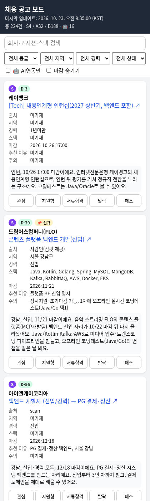
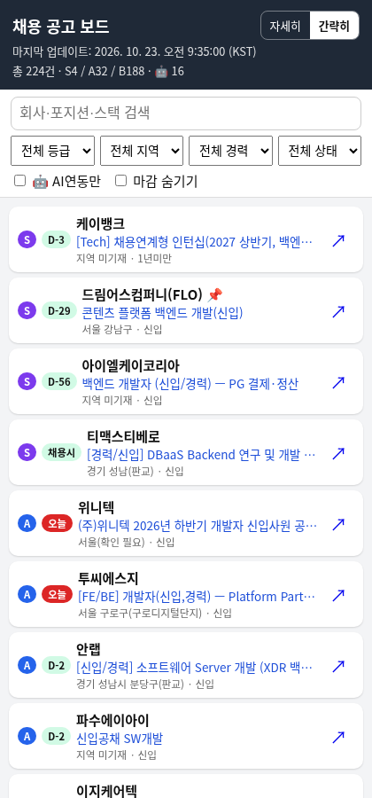

# 📋 Job Board — 백엔드 신입 채용 보드

[](https://henu-1004.github.io/job-board/)
[](https://github.com/henu-1004/job-board/commits/main)


> Java/Spring 백엔드 신입 채용 현황을 매일 아침 자동 수집해 S/A/B로 등급을 매긴 개인 채용 보드

## 👉 [**henu-1004.github.io/job-board 바로가기**](https://henu-1004.github.io/job-board/)

<p align="center"> </p>

## ✨ 주요 기능

- **🔥 오늘 꼭 볼 TOP 5** — 등급·마감 임박·신규·AI연동 점수로 고른 5건 (탭하면 해당 카드로 이동)
- **🗂️ 지난 공고 탭** — 마감·목록에서 빠진 공고를 영구 보관, 마감 월별로 묶어 검색·등급·🤖 필터 (내 지원 상태도 표시)
- **등급 정렬** — S → A → B, 같은 등급 안에서는 마감 임박 순
- **D-day 배지** — 오늘·내일 마감은 빨간색, 마감된 공고는 흐리게 맨 아래 표시, 마감 3일 후 자동 숨김
- **필터 & 검색** — 등급·지역·경력·내 상태 필터, 회사/포지션/스택 검색
- **🤖 AI연동** — LLM·RAG 등 AI 서비스와 연동하는 Spring 백엔드 공고만 모아보기
- **📌 신규** — 새로 올라온 공고 표시
- **지원 상태 저장** — 관심 / 지원함 / 서류합격 / 탈락 / 패스 (브라우저 localStorage)
- **간략히 / 자세히 보기** — 한 줄 요약 목록으로 훑어보고, 탭하면 전체 카드로 펼침 (선택 기억)
- **모바일 최적화** — 휴대폰에서 바로 확인 가능한 카드형 UI

## 🏷️ 등급 기준

| 등급 | 의미 | 기준 |
|:---:|---|---|
| **S** | 강력 추천 — 바로 검토·지원 | Java/Spring 백엔드 직무 + 신입 명시, 스택·도메인(핀테크/플랫폼) 적합 |
| **A** | 지원할 만함 | 백엔드 오너십(API·DB·인증·배포)이 분명하고 신입/1년 미만 지원 가능 |
| **B** | 일부 불일치지만 볼 만함 | 1~3년 요구, 인접 직무, 또는 '신입 가능'이지만 경력 채용 성향 |

- C 이하·3년 초과 경력 요구·채용연계 부트캠프는 수집하지 않습니다.
- 같은 등급 안에서는 신입 → 1년 미만 → 1~3년 순으로 우선합니다.

## 🔄 업데이트 방식

```
매일 ~09:00 KST  채용 사이트 스캔 (사람인 · 원티드 · 점핏 · 공식 채용 페이지)
       ↓          중복 제거 · 마감 확인 · S/A/B 등급 부여
data/jobs.json   커밋 & push  (마감·사라진 공고는 data/archive.json으로 이동, 삭제 없음)
       ↓
GitHub Pages     정적 사이트 자동 배포 (빌드 단계 없음)
```

## 🧩 `top5` 필드 (선택)

`data/jobs.json` 최상위에 `top5` 배열이 있으면 그대로 사용하고, 없으면 사이트가 자동 계산합니다.

```json
{
  "as_of": "2026-10-23T09:35+09:00",
  "items": [ ... ],
  "top5": [
    { "link": "https://www.saramin.co.kr/zf_user/jobs/view?rec_idx=55354317", "why": "S급·플랫폼 BE 신입·D-3" }
  ]
}
```

| 키 | 설명 |
|---|---|
| `link` | 공고 URL (`items[].url`과 일치). `id`(`job_id`)로도 지정 가능 |
| `why` | 추천 이유 한 줄 (생략 시 자동 생성) |

자동 계산: 마감·지원함·탈락·패스 공고 제외 → 등급(S 30 / A 20 / B 10) + 7일 내 마감(10−D) + 신규 5 + 🤖 3 점수 순 상위 5건.

## 📁 파일 구조

```
job-board/
├── index.html        # 페이지 골격
├── app.js            # 데이터 로딩 · 정렬 · 필터 · 상태 저장
├── style.css         # 모바일 우선 스타일
├── version.json      # 캐시 무효화용 에셋 버전
├── data/jobs.json    # 매일 갱신되는 진행 중 공고
├── data/archive.json # 지난 공고 누적 보관 (closed_at, archive_reason)
└── docs/screenshot.png
```

## 🛠️ 기술 스택

- HTML5 · CSS3 · Vanilla JavaScript (프레임워크·빌드 없음)
- GitHub Pages (main 브랜치 루트)
- 데이터 갱신: Bash + `gh` CLI 스크립트

---
<sub>개인용 보드입니다 · 검색엔진 색인 제외(noindex)</sub>
